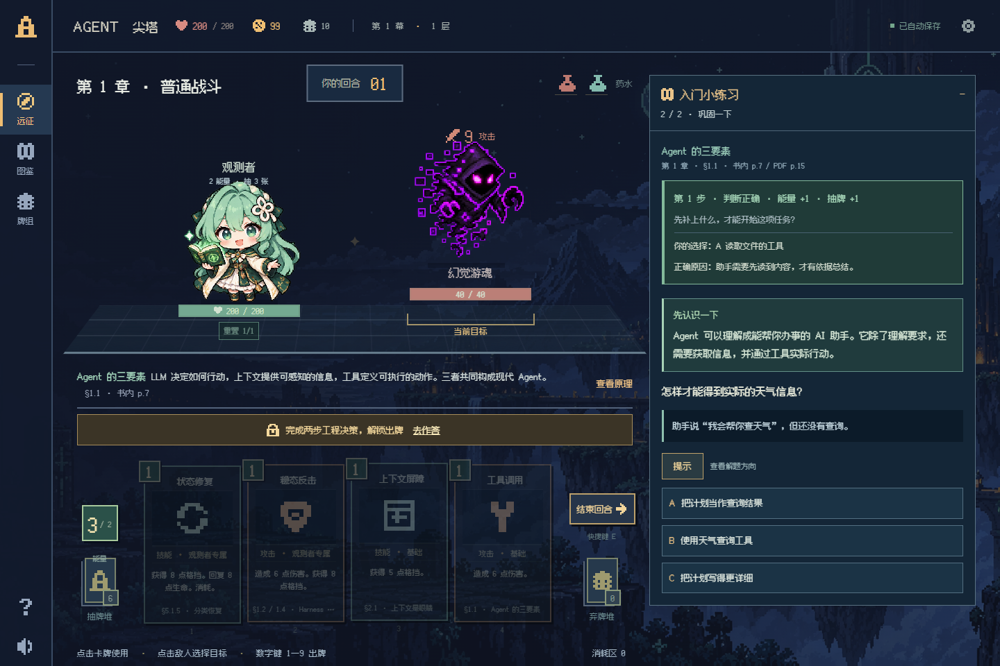

<div align="center">

# Agent 尖塔

**在出牌、排错与抉择中，深入理解 AI Agent。**

可离线游玩的像素风单人卡牌爬塔游戏。以李博杰《深入理解 AI Agent：设计原理与工程实践》为教材，把十章知识变成一场九十层的远征。

[](https://github.com/lizaixi01/agent-spire/actions/workflows/ci.yml)
[](https://github.com/lizaixi01/agent-spire/releases/latest)


[**在线体验 · 打开即玩**](https://lizaixi01.github.io/agent-spire/) · [**下载游玩包**](https://github.com/lizaixi01/agent-spire/releases/latest) · [快速开始](#快速开始) · [玩法](#怎么玩) · [开发](#参与开发)


</div>

## 为什么玩 Agent 尖塔

- **边构筑，边理解。** 73 张可升级卡牌、三种专属角色构筑，配合连携、遗物、药水、商店与篝火。
- **从零开始做判断。** 60 道生活化情境题先解释小知识，再用具体例子练习；战斗、试炼和图鉴均提供按需提示与逐项解析，无需编程基础。
- **逐章探索。** 从 ReAct、上下文工程、RAG、工具与 MCP，一路走到评估、后训练、持续进化和多 Agent 协作。知识图鉴保留章节与页码。
- **一局一条路线。** 十章十幕、90 层；十种首领机制与章节事件围绕本章知识设计，从窗口预算、接口契约到连续验收和分工协作，固定种子可复现远征。
- **逐次呈现真实命中。** 连击按实际格挡与扣血逐拍显示，破盾、击破和敌方行动配有分层音画反馈，支持减少动态效果。
- **打开就接着玩。** 自动本地存档、键盘与拖牌操作、移动布局，音乐与音效独立开关，支持减少动态效果。

游戏完全在浏览器本地运行，不调用大模型，无需账号、API 密钥或后端服务。卡面由 SVG 绘制，音频由 Web Audio 合成。

## 快速开始

### 在线体验（推荐）

打开 [Agent 尖塔在线版](https://lizaixi01.github.io/agent-spire/) 即可游玩，无需安装 Node.js、下载游戏或配置 API 密钥。推荐使用桌面浏览器；手机也可访问。

进度保存在当前浏览器，在线版与本地下载版的存档分别保存，不会自动同步。

### 下载离线游玩

<!-- release-version:start -->
当前版本 **v0.1.4** · 游玩包 **`agent-spire-v0.1.4-play.zip`** · [在线体验](https://lizaixi01.github.io/agent-spire/) · [下载与精确体积](https://github.com/lizaixi01/agent-spire/releases/latest)
<!-- release-version:end -->

1. 从 [Releases](https://github.com/lizaixi01/agent-spire/releases/latest) 下载上述 **`-play.zip`**，解压整个文件夹。GitHub 自动生成的 Source code 是开发源码。
2. 安装 [Node.js](https://nodejs.org/) 22.12+，也兼容 20.19+。
3. **Windows：**双击 `启动游戏.cmd`。**macOS / Linux：**在解压目录运行 `node scripts/serve-game.mjs`，打开 <http://127.0.0.1:4173/>。

游玩包已构建完成，**不需要安装 npm 依赖或 Python**；安装好 Node.js 后可离线游玩。请通过启动器打开，不要直接双击 `dist/index.html`。

### 下载有多轻

游玩 ZIP 设置 **10 MiB 硬上限**，精确体积自动写入每版 Release 说明和清单。只打包游戏、三张使用中的图片、中文像素字体与许可、零依赖启动器；不附带 Node.js、`node_modules`、测试截图、教材 PDF 或停用素材。校验值见附件 `SHA256SUMS.txt`，版本、提交与精确体积见 `RELEASE-MANIFEST.json`。

在线版的 [构建信息](https://lizaixi01.github.io/agent-spire/build-info.json) 与游玩包内 `dist/build-info.json` 可核对版本和 Git 提交；正式发布的 `uncommitted` 应为 `false`。同一版源码、在线版和下载包使用同一个提交。

源码仓库同样排除依赖、构建目录和历史素材。只需最新源码时：

```sh
git clone --depth 1 https://github.com/lizaixi01/agent-spire.git
```

## 怎么玩

选择角色 → 规划路线 → 阅读敌人意图 → 完成工程决策 → 出牌与连携 → 领取奖励、调整牌组 → 挑战章节首领。

| 角色 | 构筑方向 |
| --- | --- |
| 绿色观测者 | 100 生命、稳守反击，每幕一次重置回复 30 |
| 橙色铸序师 | 力量、多段攻击与高费爆发 |
| 蓝色织忆者 | 5 能量、大手牌与择机连奏，丝线每回合触发一次 |

| 操作 | 方法 |
| --- | --- |
| 使用手牌 | 点击，或数字键 `1`—`9` |
| 选择攻击目标 | 点击敌人，或把攻击牌拖到敌人身上 |
| 结束回合 | `E` |
| 关闭面板 / 取消拖牌 | `Esc` |
| 手机浏览手牌 | 左右滑动 |

推荐桌面端游玩。战斗中的两步小练习完成后解锁本场出牌；第一步作答后直接显示所选答案的原因，答错时同时给出正确选项及其依据，第二步和重载后保留解析。战斗小练习、知识试炼和图鉴练习在未作答时均可点击“提示”，查看当前题目的解题思路；换题后重新收起，提示不改变答案、奖励或存档。首领规则、进度与下次行动在战斗中公开。



### 存档与升级

进度保存在当前浏览器的当前站点地址中。关闭页面后，使用同一浏览器、同一地址即可继续；清除站点数据会删除进度。开发端口 `5173` 与游玩端口 `4173` 的存档独立。

升级时解压新游玩包并重新启动，保持原浏览器和端口即可读取已有存档。更换目录不影响浏览器存档。Windows 启动器的本地服务在后台运行，重启电脑后停止；替换版本前需先停止旧服务，避免继续读到旧版。

## 学习内容与边界

| 章节 | 核心主题 |
| --- | --- |
| 1—2 | Agent 三要素、ReAct、Harness、上下文边界与压缩 |
| 3—4 | 长期记忆、RAG、混合检索、工具接口与 MCP |
| 5—6 | Coding Agent、故障恢复、隔离执行与交互 |
| 7—8 | 可重复评估、Pass@k / Pass^k、SFT / RL |
| 9—10 | 持续进化、知识迁移、多 Agent 协作与审核 |

教材版本为 v2.0（2026-09-23）。31 个知识节点带章节、正文页码与 PDF 页码；入门情境题是对教材原则的应用；历史代码题库保留用于旧存档兼容与回归验证。图鉴覆盖核心概念，未将全书每个小节游戏化。原书 PDF 不随项目分发。

这是借鉴卡牌构筑与路线选择机制的原创教学游戏。战斗数值、角色形象与奖励属于游戏设计，不代表真实模型性能或官方合作。自动通关回归验证流程可达性，不代表人类玩家胜率或教学效果。

## 参与开发

需要 Node.js 22.12+（或 20.19+）；运行完整测试与打包还需要 Python 3。项目使用 TypeScript、Vite、Vitest，无运行时 npm 依赖。

```sh
npm ci
npm run dev
```

```sh
npm test              # 包含实际执行 Python 代码样例的验证
npm run check         # TypeScript 类型检查
npm run build         # 生成 dist/
npm run build:pages   # 生成 GitHub Pages 网页版 dist-pages/
npm start             # 本地运行构建结果，默认 4173
npm run release:pack  # 构建、打包并检查 10 MiB 体积上限
npm run release       # 提交并推送 main，由 GitHub Actions 自动发布；推送后可关终端
```

每次推送到 `main`，GitHub Actions 自动递增补丁版本、同步 lockfile 与 README 下载入口、测试、部署在线版并发布轻量包，完成前核对版本和哈希。整个过程在云端运行，推送成功后可关闭本地终端。PR 和其他分支仅检查，不发布。

维护者也可运行 `npm run release` 或在 Windows 双击 `发布更新.cmd`，自动提交并推送本地修改。机器人会回写版本提交，下次开发前先 `git pull --ff-only`；失败在 Actions 中重试，详见 [云端发布说明](docs/RELEASING.md)。

| 路径 | 用途 |
| --- | --- |
| `src/engine.ts` | 确定性游戏状态机 |
| `src/cards.ts` | 角色、卡牌与遗物规则 |
| `src/content.ts`、`src/beginner-content.ts` | 教材映射与入门情境题 |
| `src/trial-bank.ts` | 历史代码题库与兼容验证 |
| `src/impact.ts`、`src/combat-effects.ts` | 实际命中时间线与音画反馈 |
| `src/save.ts`、`src/ownership.ts` | 存档校验与历史兼容 |
| `src/main.ts`、`src/audio.ts` | 界面与浏览器音频 |
| `tests/`、`scripts/` | 行为测试、浏览器回归与发布工具 |

提交修改前请运行测试、类型检查和生产构建。问题反馈请附复现步骤、浏览器版本、角色与种子；涉及存档时请先备份。

- [工程说明与浏览器回归](docs/ENGINEERING.md)
- [角色归属与存档约定](docs/OWNERSHIP.md)
- [十章首领、事件与教学反馈](docs/CHAPTER-ENCOUNTERS.md)
- [TDD 与验证记录](docs/TDD.md)
- [资源出处与字体许可](docs/ASSETS.md)
- [发布维护说明](docs/RELEASING.md)

## 致谢与许可说明

知识来源：李博杰《深入理解 AI Agent：设计原理与工程实践》。玩法参考：[Mega Crit 官方资料](https://www.megacrit.com/press-kits/slay-the-spire-2/)。字体：[Fusion Pixel](https://github.com/TakWolf/fusion-pixel-font)，OFL 与上游许可随字体保留。

仓库暂未授予统一开源许可；教材、品牌与用户提供的角色图权利分别归对应权利人所有，资源出处详见资源说明。

README 的信息组织参考 [Excalidraw](https://github.com/excalidraw/excalidraw) 与 [Front-End Checklist](https://github.com/thedaviddias/Front-End-Checklist)：先展示项目与使用入口，再提供功能、开发说明和详细文档。内容与截图均来自本项目。
